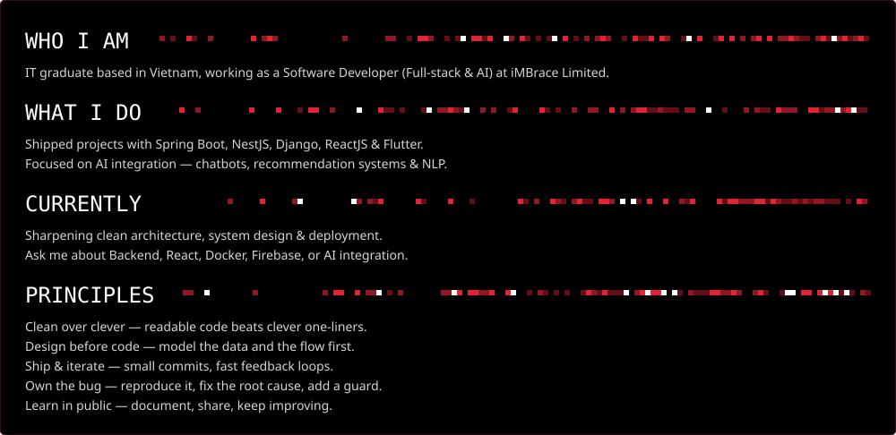
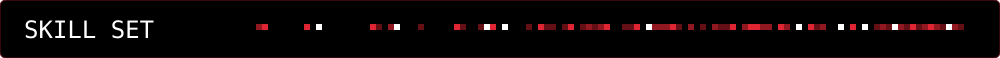
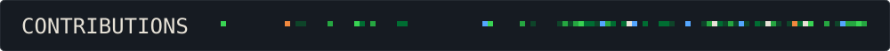
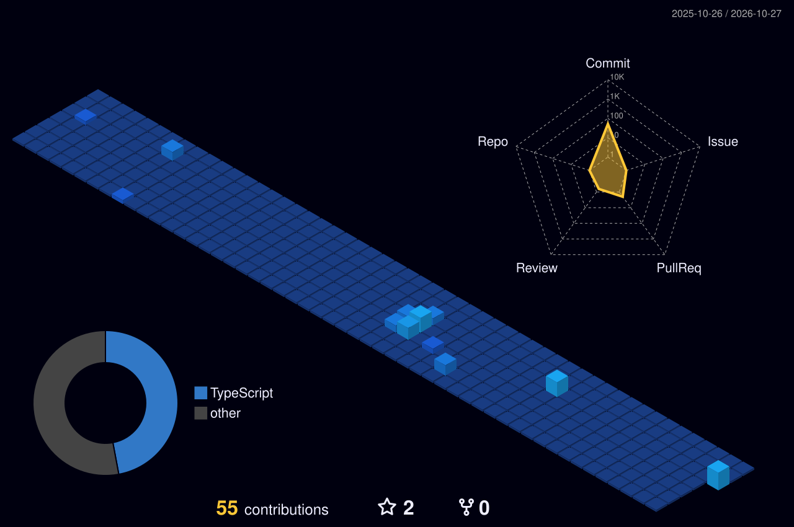
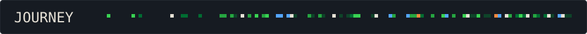
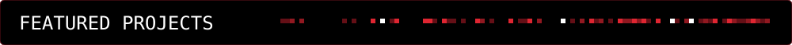
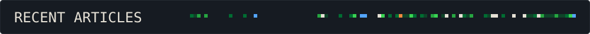

<!-- ============================ HERO ============================ -->

  

<!-- ============================ ABOUT ============================ -->

  

  

<!-- ============================ CONNECT ============================ -->

  

<table align="center">
  <tr>
    <th>GitHub</th>
    <th>Email</th>
  </tr>
  <tr>
    <td align="center"></td>
    <td align="center"></td>
  </tr>
</table>

  
  

<!-- ============================ SKILL SET ============================ -->

  

<table align="center">
  <tr>
    <td align="center" width="11%"> Java</td>
    <td align="center" width="11%"> JavaScript</td>
    <td align="center" width="11%"> TypeScript</td>
    <td align="center" width="11%"> Python</td>
    <td align="center" width="11%"> HTML</td>
    <td align="center" width="11%"> CSS</td>
    <td align="center" width="11%"> Spring</td>
    <td align="center" width="11%"> Hibernate</td>
    <td align="center" width="11%"> NestJS</td>
  </tr>
  <tr>
    <td align="center" width="11%"> Express</td>
    <td align="center" width="11%"> Node.js</td>
    <td align="center" width="11%"> Django</td>
    <td align="center" width="11%"> FastAPI</td>
    <td align="center" width="11%"> React</td>
    <td align="center" width="11%"> Redux</td>
    <td align="center" width="11%"> Bootstrap</td>
    <td align="center" width="11%"> Tailwind</td>
    <td align="center" width="11%"> Flutter</td>
  </tr>
  <tr>
    <td align="center" width="11%"> Dart</td>
    <td align="center" width="11%"> Firebase</td>
    <td align="center" width="11%"> MySQL</td>
    <td align="center" width="11%"> PostgreSQL</td>
    <td align="center" width="11%"> MongoDB</td>
    <td align="center" width="11%"> SQLite</td>
    <td align="center" width="11%"> PyTorch</td>
    <td align="center" width="11%"> TensorFlow</td>
    <td align="center" width="11%"> Docker</td>
  </tr>
  <tr>
    <td align="center" width="11%"> Git</td>
    <td align="center" width="11%"> GitHub</td>
    <td align="center" width="11%"> GitLab</td>
    <td align="center" width="11%"> Actions</td>
    <td align="center" width="11%"> Linux</td>
    <td align="center" width="11%"> VS Code</td>
    <td align="center" width="11%"> IntelliJ</td>
    <td align="center" width="11%"> Postman</td>
    <td align="center" width="11%"> Notion</td>
  </tr>
</table>

<!-- ============================ CONTRIBUTIONS ============================ -->

  

  

<!-- ============================ JOURNEY ============================ -->

  

  

<!-- ============================ PROJECTS ============================ -->

  

  

<!-- ============================ ARTICLES ============================ -->

  

  

<!-- ============================ FOOTER ============================ -->

  

