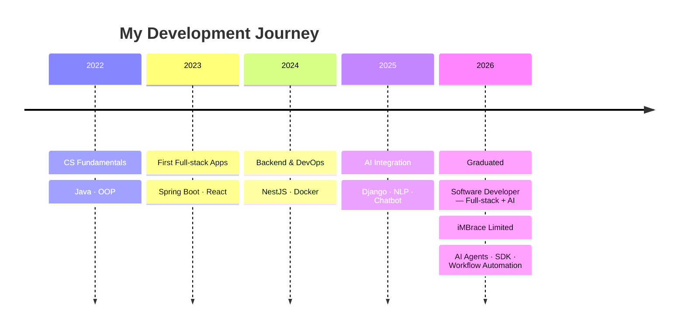
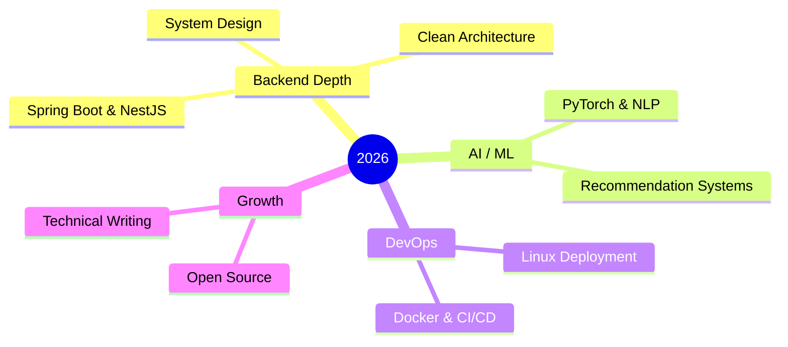

<div align="center">
  
</div>

<!-- ============================ GLOBE HERO (GIF) ============================ -->

<p align="center">
  
</p>

<!-- ============================ SOCIALS ============================ -->

<div align="center">
  <a href="https://github.com/hoangtuanphong1a" target="_blank">
    
  </a>
  <a href="https://linkedin.com/in/yourprofile" target="_blank">
    
  </a>
  <a href="https://dev.to/yourprofile" target="_blank">
    
  </a>
  <a href="mailto:hoangtuanphong1a@gmail.com">
    
  </a>
</div>

<div align="center">
  
  
</div>

<br/>

<!-- ============================ ABOUT ============================ -->

## About Me

- Graduated in IT, working as a **Software Developer (Full-stack &amp; AI)**
- Shipped projects with **Spring Boot, NestJS, Django, ReactJS &amp; Flutter**
- Focused on **AI integration** — chatbots, recommendation systems &amp; NLP
- Currently sharpening **clean architecture, system design &amp; deployment**
- Ask me about **Backend, React, Docker, Firebase, or AI integration**

```typescript
const phong = {
  role: "Software Developer",
  location: "Vietnam",
  focus: ["Full-stack Web", "AI Integration", "Software Project Management"],
  stack: ["Spring Boot", "NestJS", "Django", "React", "Flutter"],
  building: ["B2C platform w/ AI chatbot", "AI-powered IELTS learning system"],
  mindset: "Learn by shipping real projects.",
};
```

<p align="center">
  
</p>

<!-- ============================ BANNER ============================ -->

<!-- ============================ TECH STACK (bento + skillicons) ============================ -->

## Tech Stack

<table width="100%">
  <tr>
    <td width="25%" valign="top" align="center">
      <h3>Languages</h3>
      
    </td>
    <td width="25%" valign="top" align="center">
      <h3>Backend</h3>
      
    </td>
    <td width="25%" valign="top" align="center">
      <h3>Frontend</h3>
      
    </td>
    <td width="25%" valign="top" align="center">
      <h3>Mobile</h3>
      
    </td>
  </tr>
  <tr>
    <td width="25%" valign="top" align="center">
      <h3>Database</h3>
      
    </td>
    <td width="25%" valign="top" align="center">
      <h3>AI / ML</h3>
      
    </td>
    <td width="25%" valign="top" align="center">
      <h3>DevOps</h3>
      
    </td>
    <td width="25%" valign="top" align="center">
      <h3>Tools</h3>
      
    </td>
  </tr>
</table>

<!-- ============================ DASHBOARD ============================ -->

## Software Engineering Dashboard

<div align="center">
  
</div>

<div align="center">
  
</div>

<div align="center">
  
  
  
</div>

<!-- ============================ TOP LANGUAGES ============================ -->

## Top Languages

<div align="center">
  
  
  
  
  
  
  
  
</div>

<!-- ============================ HIGHLIGHTS ============================ -->

## Highlights

<div align="center">
  
  
  <br/>
  
  
</div>

<!-- ============================ ENGINEERING PRINCIPLES ============================ -->

## Engineering Principles

> **Clean over clever** — readable code beats clever one-liners.
>
> **Design before code** — model the data and the flow first.
>
> **Ship &amp; iterate** — small commits, fast feedback loops.
>
> **Own the bug** — reproduce it, fix the root cause, add a guard.
>
> **Learn in public** — document, share, keep improving.

<!-- ============================ DEVELOPMENT JOURNEY ============================ -->

## Development Journey



<!-- ============================ PROJECTS ============================ -->

## Featured Projects

<table width="100%">
  <tr>
    <td width="50%" valign="top">
      <h3>Invoice Extraction Agent</h3>
      <p>AI agent trích xuất dữ liệu hoá đơn &amp; tự động hoá document schema.</p>
      <p>
        
        
        
      </p>
    </td>
    <td width="50%" valign="top">
      <h3>Agent SDK &amp; Workflow Automation</h3>
      <p>SDK cho AI agent và các luồng workflow automation, kèm backend API.</p>
      <p>
        
        
        
      </p>
    </td>
  </tr>
  <tr>
    <td width="50%" valign="top">
      <h3>B2C Sales Platform + AI Chatbot</h3>
      <p>Full-stack e-commerce với chatbot AI tư vấn & hỗ trợ khách hàng tự động.</p>
      <p>
        
        
        
        
      </p>
    </td>
    <td width="50%" valign="top">
      <h3>IELTS AI Learning System</h3>
      <p>Nền tảng luyện thi IELTS cá nhân hóa bằng AI/NLP theo từng người học.</p>
      <p>
        
        
        
        
      </p>
    </td>
  </tr>
  <tr>
    <td width="50%" valign="top">
      <h3>Task Management System</h3>
      <p>Quản lý công việc: task CRUD, checklist, attachment, deadline, priority & gán thành viên.</p>
      <p>
        
        
      </p>
    </td>
    <td width="50%" valign="top">
      <h3>Coffee Shop Management</h3>
      <p>Hệ thống quản lý quán: đăng nhập, quản lý bàn, người dùng & phân quyền.</p>
      <p>
        
        
        
        
      </p>
    </td>
  </tr>
  <tr>
    <td width="50%" valign="top">
      <h3>Facebook Clone (Flutter)</h3>
      <p>Social app: post, story, like, comment, notification & birthday events.</p>
      <p>
        
        
      </p>
    </td>
    <td width="50%" valign="top">
      <h3>Current Strengths</h3>
      <p>
        Full-stack Web (Spring Boot · NestJS · Django)<br/>
        React Frontend & Database Design<br/>
        Docker & Deployment · Firebase<br/>
        AI Integration · Agile Workflow
      </p>
    </td>
  </tr>
</table>

<!-- ============================ GOALS ============================ -->

## 2026 Goals



<!-- ============================ FOOTER ============================ -->

<div align="center">
  
</div>
