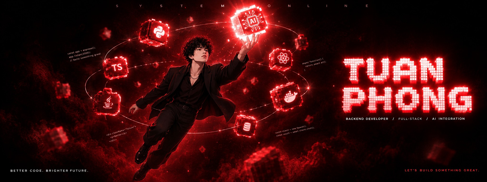
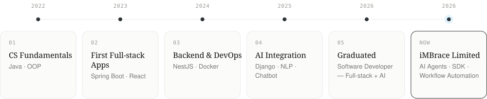
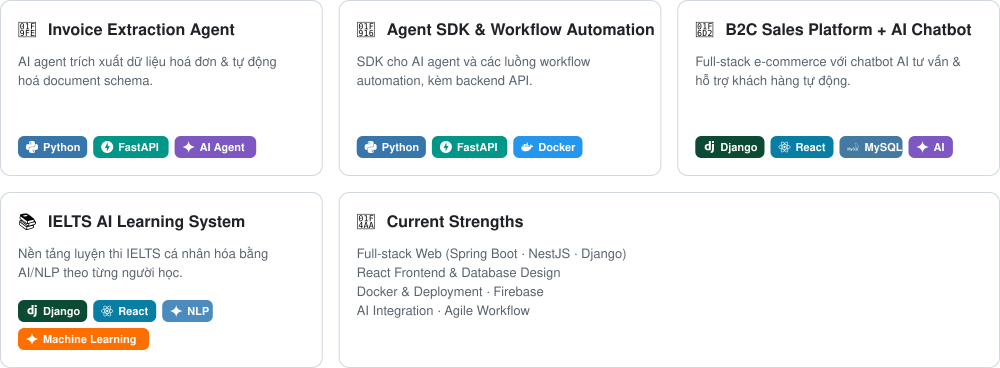
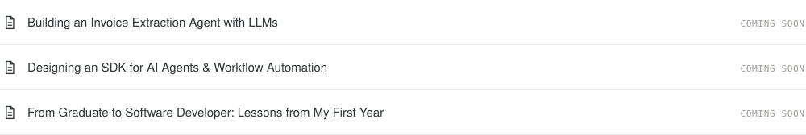

<!-- ============================ HERO ============================ -->

  

<!-- ============================ ABOUT ============================ -->

<h3 align="center">Who Am I?</h3>

I am an IT graduate and a <b>Software Developer</b> focused on <b>Full-stack &amp; AI</b>, based in Vietnam. I like turning ideas into products that actually run, and I learn best by <b>shipping real projects</b> rather than only reading about them.

Over time I have built and shipped projects with <code>Spring Boot</code>, <code>NestJS</code>, <code>Django</code>, <code>ReactJS</code> and <code>Flutter</code>, covering <b>backend APIs</b>, <b>web frontends</b> and <b>mobile apps</b>, backed by <code>MySQL</code> and <code>PostgreSQL</code>.

Right now my focus is <b>AI integration</b>: <code>AI agents</code>, <b>workflow automation</b>, chatbots, recommendation systems and NLP. Alongside that I keep sharpening <b>clean architecture</b>, <b>system design</b> and <b>deployment</b> with <code>Docker</code>. Ask me about Backend, React, Docker, Firebase, or AI integration.

 

  
  

  

<!-- ============================ TECH STACK ============================ -->

<h3 align="center">Tech Stack</h3>

  
  
  
  
  
  
  
  
  
  
   
  
  
  
  
  
  
  
  
  
  

<!-- ============================ STACKS ============================ -->

<h3 align="center">My Stacks</h3>

  

<!-- ============================ JOURNEY ============================ -->

<h3 align="center">Journey</h3>

  

<!-- ============================ PROJECTS ============================ -->

<h3 align="center">Featured Projects</h3>

  

<!-- ============================ REPOSITORIES ============================ -->

<h3 align="center">My Repositories</h3>

  

<!-- ============================ ARTICLES ============================ -->

<h3 align="center">Recent Articles</h3>

  

<!-- ============================ FOOTER ============================ -->

  

