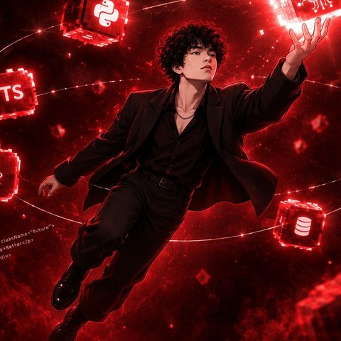
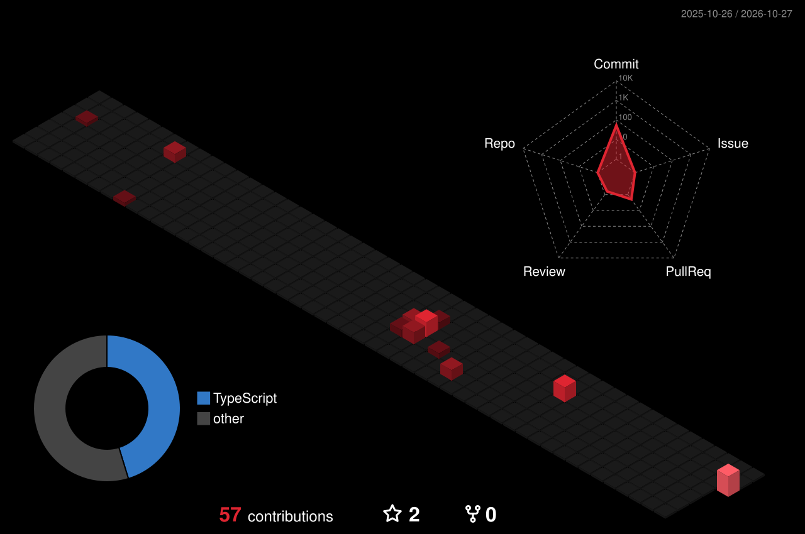

<!-- ============================ HERO ============================ -->

  

  
  
  

<!-- ============================ ABOUT ============================ -->

<h3 align="center">Who Am I?</h3>

<table align="center">
  <tr>
    <td width="36%" align="center">
      
    </td>
    <td width="64%" valign="middle">
      
IT graduate based in Vietnam, working as a <b>Software Developer (Full-stack &amp; AI)</b> at <b>iMBrace Limited</b>.

      
Shipped projects with <b>Spring Boot, NestJS, Django, ReactJS &amp; Flutter</b>. Focused on <b>AI integration</b> — chatbots, recommendation systems &amp; NLP.

      
Currently sharpening <b>clean architecture, system design &amp; deployment</b>. Ask me about Backend, React, Docker, Firebase, or AI integration.

    </td>
  </tr>
</table>

<h3 align="center">A Bit More About Me</h3>

<table align="center">
  <tr>
    <td>
      <ul>
        <li><b>Clean over clever</b> — readable code beats clever one-liners.</li>
        <li><b>Design before code</b> — model the data and the flow first.</li>
        <li><b>Ship &amp; iterate</b> — small commits, fast feedback loops.</li>
        <li><b>Own the bug</b> — reproduce it, fix the root cause, add a guard.</li>
        <li><b>Learn in public</b> — document, share, keep improving.</li>
      </ul>
    </td>
  </tr>
</table>

  
  

  

<!-- ============================ GITHUB STATUS ============================ -->

<h3 align="center">GitHub Status</h3>

  

  

<!-- ============================ STACKS ============================ -->

<h3 align="center">My Stacks</h3>

  

<!-- ============================ JOURNEY ============================ -->

<h3 align="center">Journey</h3>

  

<!-- ============================ PROJECTS ============================ -->

<h3 align="center">Featured Projects</h3>

  

<!-- ============================ REPOSITORIES ============================ -->

<h3 align="center">My Repositories</h3>

  

<!-- ============================ ARTICLES ============================ -->

<h3 align="center">Recent Articles</h3>

  

<!-- ============================ FOOTER ============================ -->

  

