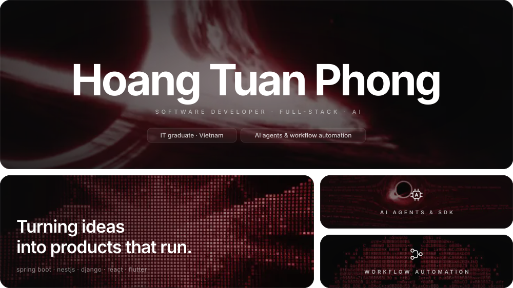
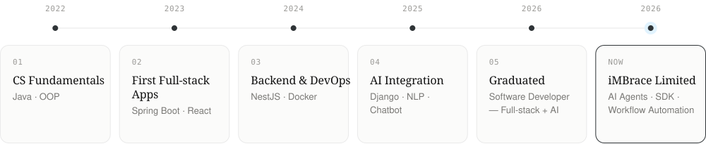
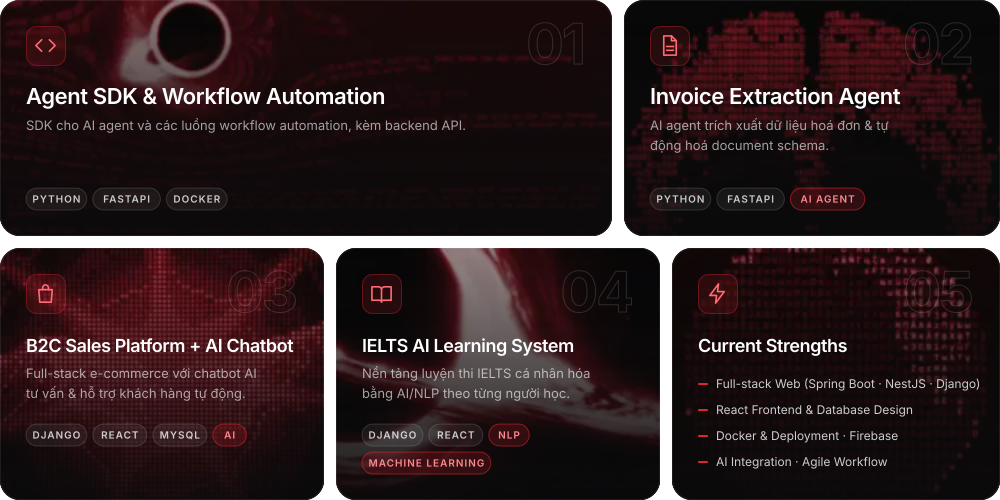

<!--
  README.md is generated from readme.source.md by readme-aura (GitHub Action on push to main).
  Edit readme.source.md, never README.md. Local preview: npx readme-aura build
  assets/hero.svg is hand-built (not by readme-aura).
-->

<!-- ============================ HERO ============================ -->

<p align="center">
  
</p>

<!-- ============================ LINKS ============================ -->

```aura width=132 height=48 link="https://github.com/hoangtuanphong1a" inline align=center
<div style={{ display: 'flex', alignItems: 'center', justifyContent: 'center', width: '100%', height: '100%' }}>
  <SocialMediaButton
    icon="https://skillicons.dev/icons?i=github"
    text="GitHub"
    backgroundColor="#0E0E10"
    textColor="#F2F2F2"
    borderColor="#2A2A30"
    width={120}
    height={44}
    iconSize="20"
    gradientStops={[
      { offset: '0%', color: '#FFFFFF' },
      { offset: '10%', color: '#111111' },
      { offset: '50%', color: '#EEEEEE' },
      { offset: '60%', color: '#DF2531' },
      { offset: '80%', color: '#111111' },
      { offset: '100%', color: '#555555' },
    ]}
  />
</div>
```

```aura width=142 height=48 link="https://www.linkedin.com/in/ho%C3%A0ng-tu%E1%BA%A5n-phong-787846376" inline align=center
<div style={{ display: 'flex', alignItems: 'center', justifyContent: 'center', width: '100%', height: '100%' }}>
  <SocialMediaButton
    icon="https://skillicons.dev/icons?i=linkedin"
    text="LinkedIn"
    backgroundColor="#0E0E10"
    textColor="#F2F2F2"
    borderColor="#2A2A30"
    width={130}
    height={44}
    iconSize="20"
    gradientStops={[
      { offset: '0%', color: '#FFFFFF' },
      { offset: '10%', color: '#111111' },
      { offset: '50%', color: '#EEEEEE' },
      { offset: '60%', color: '#DF2531' },
      { offset: '80%', color: '#111111' },
      { offset: '100%', color: '#555555' },
    ]}
  />
</div>
```

```aura width=122 height=48 link="mailto:hoangtuanphong1a@gmail.com" inline align=center
<div style={{ display: 'flex', alignItems: 'center', justifyContent: 'center', width: '100%', height: '100%' }}>
  <SocialMediaButton
    icon="https://skillicons.dev/icons?i=gmail"
    text="Email"
    backgroundColor="#0E0E10"
    textColor="#F2F2F2"
    borderColor="#2A2A30"
    width={110}
    height={44}
    iconSize="20"
    gradientStops={[
      { offset: '0%', color: '#FFFFFF' },
      { offset: '10%', color: '#111111' },
      { offset: '50%', color: '#EEEEEE' },
      { offset: '60%', color: '#DF2531' },
      { offset: '80%', color: '#111111' },
      { offset: '100%', color: '#555555' },
    ]}
  />
</div>
```

<!-- ============================ GREETING ============================ -->

<p align="center">
  
</p>

<!-- ============================ ABOUT ============================ -->

<h3 align="center">Who Am I?</h3>


<p align="justify">
I am an IT graduate and a <b>Software Developer</b> focused on <b>Full-stack &amp; AI</b>, based in Vietnam. I like turning ideas into products that actually run, and I learn best by <b>shipping real projects</b> rather than only reading about them.
</p>

<p align="justify">
Over time I have built and shipped projects with <code>Spring Boot</code>, <code>NestJS</code>, <code>Django</code>, <code>ReactJS</code> and <code>Flutter</code>, covering <b>backend APIs</b>, <b>web frontends</b> and <b>mobile apps</b>, backed by <code>MySQL</code> and <code>PostgreSQL</code>.
</p>

<p align="justify">
Right now my focus is <b>AI integration</b>: <code>AI agents</code>, <b>workflow automation</b>, chatbots, recommendation systems and NLP. Alongside that I keep sharpening <b>clean architecture</b>, <b>system design</b> and <b>deployment</b> with <code>Docker</code>. Ask me about Backend, React, Docker, Firebase, or AI integration.
</p>

<br clear="left"/>

<!-- ============================ STACKS ============================ -->

<h3 align="center">My Stacks</h3>

<p align="center">
  
</p>

<!-- ============================ JOURNEY ============================ -->

<h3 align="center">Journey</h3>

<p align="center">
  
</p>

<!-- ============================ PROJECTS ============================ -->

<h3 align="center">Featured Projects</h3>

<p align="center">
  
</p>
